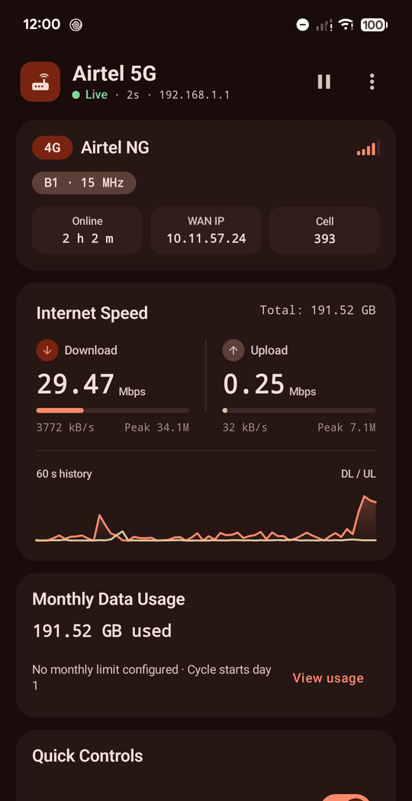
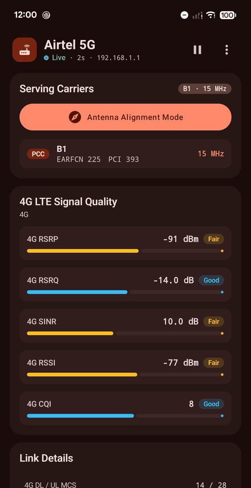
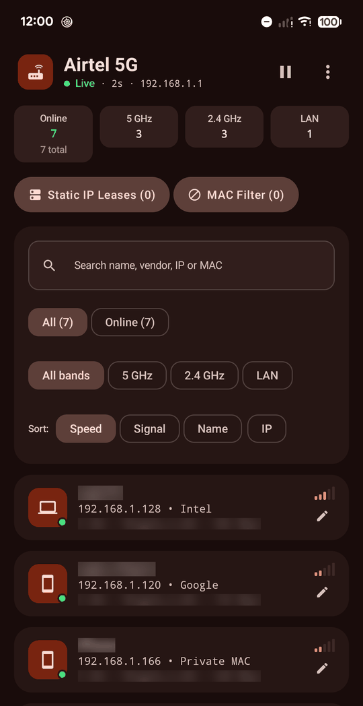
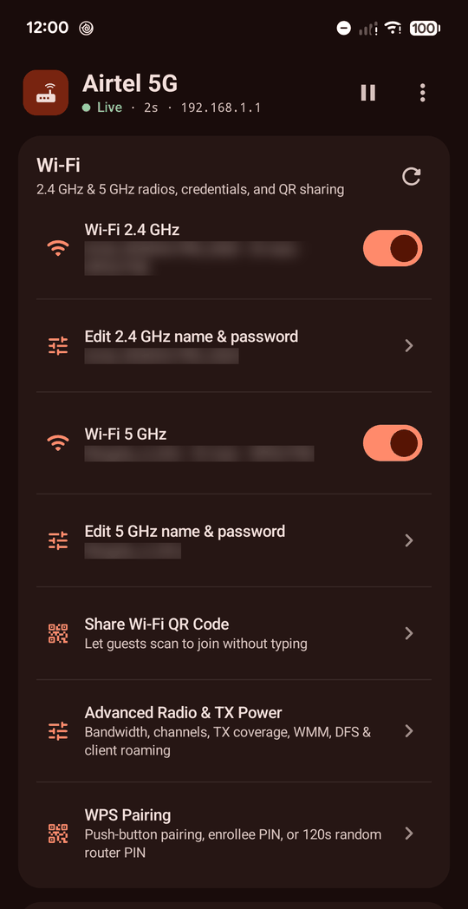
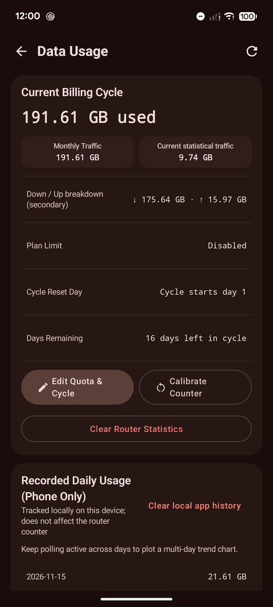
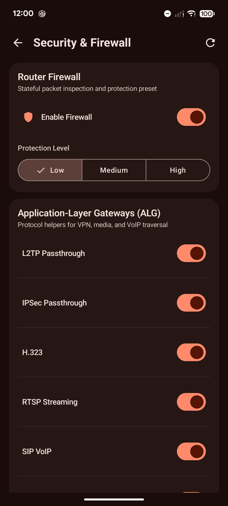
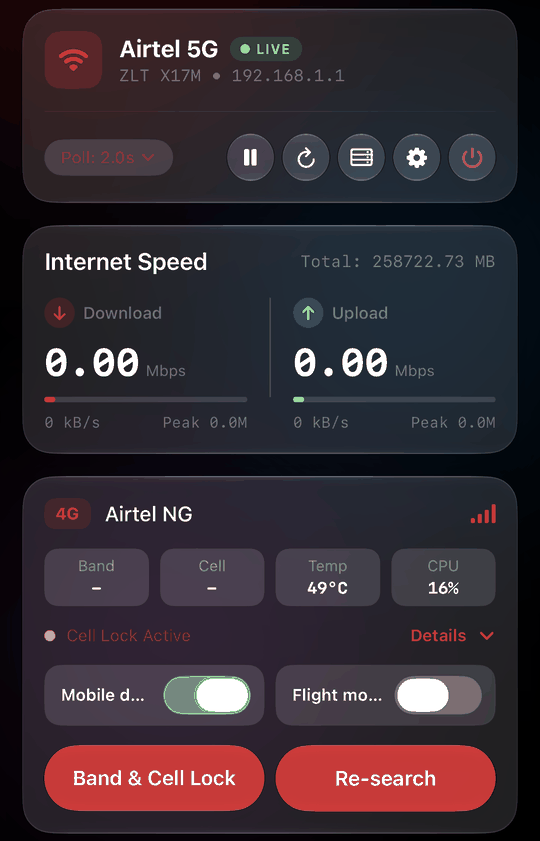
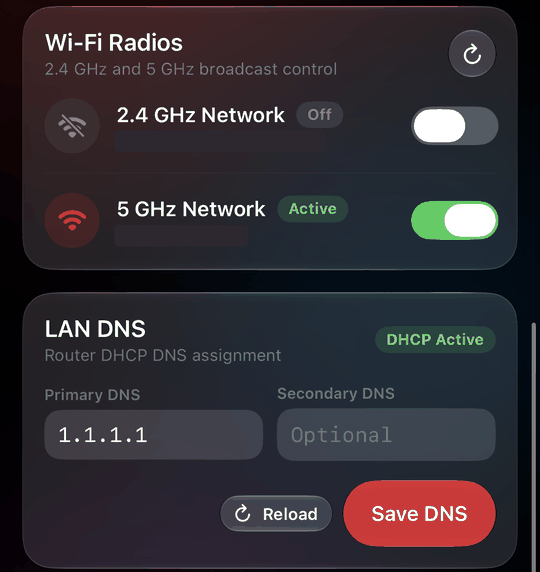

# Airtel 5G Router Monitor

Monitor and manage an **Airtel 5G router** (ODU: ZLT X17M · IDU: ZLT W304VA PRO) at `192.168.1.1` from your phone.
It talks to the router's internal CGI (`/cgi-bin/http.cgi`) with the challenge-token SHA-256 login, and covers what
you'd otherwise open the router's web page for: live speed and signal, connected devices, Wi-Fi, SMS, data usage,
security and system settings, band and cell lock, and reboot.

Ships in four forms. The desktop and Termux versions share one Python core
(standard library only, no pip dependencies); the phone apps are native rewrites (v3).

| Form | Where | Run it |
|------|-------|--------|
| **Desktop** | `desktop/` | `python desktop/server.py` (or `start_monitor.bat`), open `http://127.0.0.1:8080` |
| **Single-file / Termux** | `mobile/airtel_monitor.py` | copy to phone, run in Pydroid 3 / Termux |
| **Android app** | `app/` (native Kotlin + Compose) | APK from Releases, or build in Android Studio ([docs](docs/ANDROID_BUILD.md)) |
| **iOS app** | `iosApp/` (native SwiftUI) | IPA from Releases, sideload with SideStore/AltStore/Sideloadly ([docs](docs/IOS_BUILD.md)) |

## Screenshots

Android 3.0, live against the router. Wi-Fi and device names are blurred.

| Home | Signal | Devices |
|---|---|---|
|  |  |  |

| Settings | Data usage | Security |
|---|---|---|
|  |  |  |

The iOS app has the same four tabs and features. The iOS screenshots below are from 2.6 and will be updated:

 

## Layout
```
desktop/          Laptop app: server.py, router_client.py, static/ (web UI)
mobile/           Single-file bundle + Termux launcher + phone setup guide
app/              Native Android app (Kotlin + Jetpack Compose + OkHttp)
iosApp/           Native iOS app (Swift + SwiftUI + URLSession + CryptoKit)
tools/            build_mobile.py (single-file mobile bundle), gen_icon.py (app icons)
docs/             ANDROID_BUILD.md + IOS_BUILD.md + ANDROID_NOTES.md
```

## Source of truth & code generation
The shared logic lives in **`desktop/router_client.py`** and the UI in
**`desktop/static/`**. The single-file bundles are **generated** — after editing
the desktop sources, regenerate them:

```
python tools/build_mobile.py
```

This rewrites `mobile/airtel_monitor.py` (binds `0.0.0.0`). The Android and iOS
apps don't use it; they reimplement the client natively.

## What works and what doesn't (this firmware)
Both phone apps (3.0) have four tabs: **Home, Signal, Devices and Settings**.
- ✅ **Home:** live WAN download/upload (`cmd 18` counters, Mbps or MB/s), connection and cell summary, monthly data usage,
  and quick controls (mobile data, Wi-Fi radios).
- ✅ **Signal:** full 4G/5G RF telemetry with history, LTE + NR carrier aggregation, neighbour cells, antenna alignment
  (audio + visual), network mode, and **band lock and cell lock** (`cmd 161`/`160`).
- ✅ **Devices:** clients with OUI vendor, band, signal and link rate, aliases, a detail sheet, static DHCP leases,
  MAC filter / block, and parental controls.
- ✅ **Wi-Fi:** 2.4 / 5 GHz radios, names and passwords, QR sharing, schedule, guest Wi-Fi, WPS, TX power and advanced radio settings.
- ✅ **Mobile & SIM:** APN, network mode, SIM PIN / PUK, SMS inbox / outbox (read, compose, reply, forward, delete, settings) and USSD.
- ✅ **Data usage:** monthly and current traffic as the router's web page shows them, quota and billing cycle, calibrate and clear
  the router counter, plus a local daily history. (This firmware swaps `dl_mon_flow` / `ul_mon_flow`; the apps correct it.)
- ✅ **LAN / DHCP / DNS**, **Security** (firewall level, ALG, DDoS, UPnP, DMZ, port forwarding, IP / URL filters) and
  **System** (about, logs, self-check, router password, scheduled reboot, speed test, reboot, factory reset).
- ✅ **Safety:** every change reads the current settings first, posts the web UI's own payload, and reads back to verify.
  Disruptive changes ask for confirmation; factory reset needs typed confirmation.
- ✅ **Android extras:** onboarding with gateway auto-detection, a WorkManager background monitor with deduplicated alerts
  (quota, SMS, new device, reachability), and 2×2 / 4×2 home-screen widgets.
- ❌ **Per-device throughput:** not exposed by the firmware (no per-client counters).
- ❌ **QoS speed limiter:** not available on this firmware.

## Android
Native Kotlin + Jetpack Compose (`Material 3 Expressive`, light/dark theme tokens, adaptive phone/tablet nav, predictive back), targets **Android 17 (SDK 37)**, min Android 7.0 (`minSdk 24`).
Encrypted DataStore (`AndroidKeystore` AES-GCM) stores router credentials locally. Verify builds with `sh ./gradlew testDebugUnitTest lintDebug assembleDebug`.
Build steps: **`docs/ANDROID_BUILD.md`**. Architecture and the Android 16+ `ACCESS_LOCAL_NETWORK` permission: **`docs/ANDROID_NOTES.md`**. V3 rebuild log: **`docs/V3_PROGRESS.md`**. Router protocol notes: **`docs/ROUTER_API.md`**.

## iOS
Native SwiftUI, iOS 16+, with Liquid Glass on iOS 26 and feature parity with Android 3.0 (70 XCTests, including exact
payload tests for every settings change). Built unsigned by GitHub Actions (no Mac needed); install steps in **`docs/IOS_BUILD.md`**.

## Note
Uses the router's default LAN credentials (`root`/`admin`), changeable in the app
settings. Intended for use on your own network only.

This is an independent hobby project. It is not affiliated with or endorsed by
Airtel or ZLT; product names are used only to say which hardware it works with.

## License
[MIT](LICENSE)
