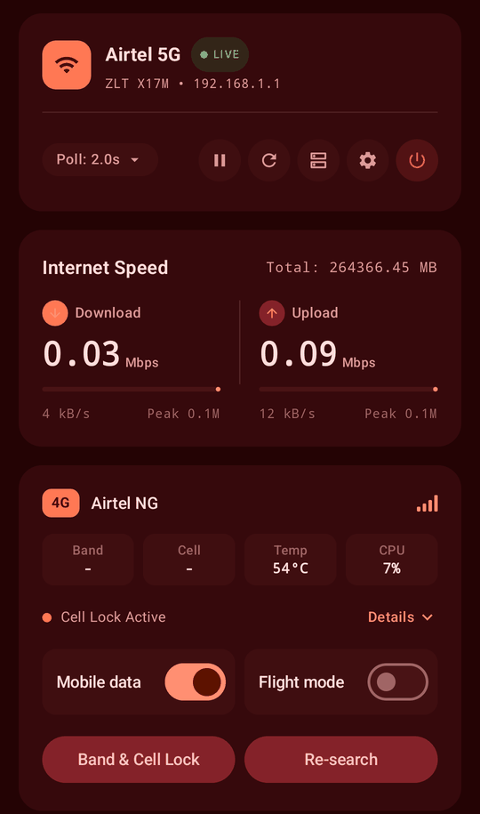
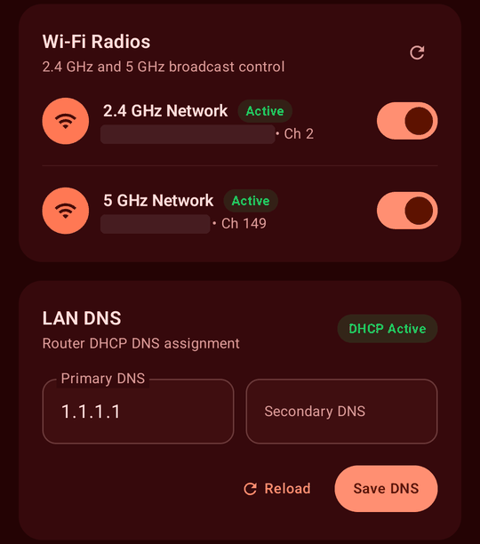
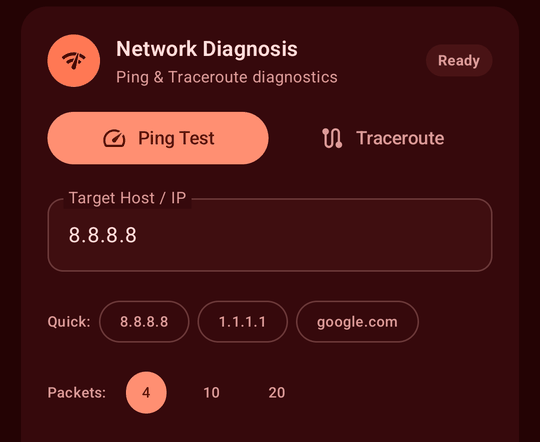

# Airtel 5G Router Monitor

Real-time bandwidth & telemetry dashboard for an **Airtel 5G router**
(ODU: ZLT X17M · IDU: ZLT W304VA PRO) at `192.168.1.1`. It talks to the router's
internal CGI (`/cgi-bin/http.cgi`) using the challenge-token SHA-256 login, and
shows live WAN throughput, connected devices, 5G/4G radio stats, and a read-only
cell-lock panel — plus router reboot.

Ships in four forms. The desktop and Termux versions share one Python core
(standard library only, no pip dependencies); the phone apps are native ports.

| Form | Where | Run it |
|------|-------|--------|
| **Desktop** | `desktop/` | `python desktop/server.py` (or `start_monitor.bat`), open `http://127.0.0.1:8080` |
| **Single-file / Termux** | `mobile/airtel_monitor.py` | copy to phone, run in Pydroid 3 / Termux |
| **Android app** | `app/` (native Kotlin + Compose) | APK from Releases, or build in Android Studio ([docs](docs/ANDROID_BUILD.md)) |
| **iOS app** | `iosApp/` (native SwiftUI) | IPA from Releases, sideload with SideStore/AltStore/Sideloadly ([docs](docs/IOS_BUILD.md)) |

## Screenshots

Live from the Android and iOS apps. Wi-Fi names are masked.

| Android | iOS |
|---|---|
|  |  |
|  |  |

Network diagnostics run ping and traceroute from the router itself:



## Layout
```
desktop/          Laptop app: server.py, router_client.py, static/ (web UI)
mobile/           Single-file bundle + Termux launcher + phone setup guide
app/              Native Android app (Kotlin + Jetpack Compose + OkHttp)
iosApp/           Native iOS app (Swift + SwiftUI + URLSession + CryptoKit)
tools/            build_mobile.py (single-file mobile bundle), gen_icon.py (app icons)
docs/             ANDROID_BUILD.md + IOS_BUILD.md + ANDROID_NOTES.md
```

## Source of truth & code generation
The shared logic lives in **`desktop/router_client.py`** and the UI in
**`desktop/static/`**. The single-file bundles are **generated** — after editing
the desktop sources, regenerate them:

```
python tools/build_mobile.py
```

This rewrites `mobile/airtel_monitor.py` (binds `0.0.0.0`). The Android and iOS
apps don't use it; they reimplement the client natively.

## What works and what doesn't (this firmware)
- ✅ Live **total** WAN download/upload (`cmd 18` byte counters, `Mbps` or `MB/s` units).
- ✅ Device list, OUI vendor lookup, custom aliases, detail sheet, static DHCP lease, and Wi-Fi ACL block/unblock.
- ✅ Full **5G / 4G RF telemetry**, LTE + NR Carrier Aggregation table, Antenna Alignment audio/visual mode, and neighbor scan.
- ✅ **Wi-Fi management** (2.4 GHz / 5 GHz radios, QR code share, scheduler, MAC filter, guest Wi-Fi, WPS), **Mobile network / APN / SIM PIN**, and **LAN / DHCP / DNS** (`cmd 3`).
- ✅ **SMS Inbox / Outbox** (read, compose, reply, forward, delete, SMS settings) & **Monthly / local daily data usage**.
- ✅ **Security & System Tools**: firewall / ALG switches, syslog viewer, scheduled reboot, self-check, router password change (`cmd 102`), router reboot, and Cloudflare speed test.
- ✅ **Onboarding, WorkManager alerts & Home-screen widgets**: Wi-Fi gateway auto-detection, deduplicated quota/SMS/device/reachability alerts, and 2×2 / 4×2 status widgets.
- ✅ **Band lock & cell lock** (Android) — choose allowed 4G/5G bands (`cmd 161`) and lock to specific 4G/5G cells by EARFCN/ARFCN + PCI (`cmd 160`) with `root` login.
- ❌ **Per-device** throughput — not exposed by the firmware (no per-client counters).
- ❌ **QoS speed limiter** & uncaptured second-hop web UI pages (`USSD`, traffic limit setter, remote traffic stats tables, `dmz`/`upnp`/`ddos`/port/URL/IP filter) — blocked or not present in captured router pages.

## Android
Native Kotlin + Jetpack Compose (`Material 3 Expressive`, light/dark theme tokens, adaptive phone/tablet nav, predictive back), targets **Android 17 (SDK 37)**, min Android 7.0 (`minSdk 24`).
Encrypted DataStore (`AndroidKeystore` AES-GCM) stores router credentials locally. Verify builds with `sh ./gradlew testDebugUnitTest lintDebug assembleDebug`.
Build steps: **`docs/ANDROID_BUILD.md`**. Architecture and the Android 16+ `ACCESS_LOCAL_NETWORK` permission: **`docs/ANDROID_NOTES.md`**. V3 rebuild log: **`docs/V3_PROGRESS.md`**.

## iOS
Native SwiftUI, iOS 16+. Built unsigned by GitHub Actions (no Mac needed); install steps in **`docs/IOS_BUILD.md`**. iOS V3 parity (`Phase 8`) is scheduled after Android review.

## Note
Uses the router's default LAN credentials (`root`/`admin`), changeable in the app
settings. Intended for use on your own network only.

This is an independent hobby project. It is not affiliated with or endorsed by
Airtel or ZLT; product names are used only to say which hardware it works with.

## License
[MIT](LICENSE)
